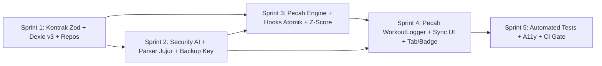

# Project Execution Plan & Backlog Terstruktur: RKStride

**Dokumen:** `docs/project-plan-odoo.md`  
**Sumber Spec:** [workout-logging](specs/workout-logging/design.md), [smartwatch-readiness](specs/smartwatch-readiness/design.md), [backup-contracts](specs/backup-contracts/design.md), [ai-coach](specs/ai-coach/design.md)  
**Aturan Dasar:** [docs/steering/tech.md](steering/tech.md)

---

## 1. Prinsip Eksekusi Backlog

1. **Urutan Prioritas Fondasi:**
   - **Sprint 1:** Kontrak & Database (Single Source of Truth Zod + Dexie v3 + Transaksi Atomik)
   - **Sprint 2:** Security, Privasi & Kejujuran Input/Output (pengganti kontrol akses server pada arsitektur client-side + fondasi validasi batas luar)
   - **Sprint 3:** Perbaikan Alur Inti (Engine terpecah, Cold-Start Proyeksi, Z-Score Readiness 14 hari, Repository-backed Hooks)
   - **Sprint 4:** UI/UX Refactor & Integrasi End-to-End (Pecah monolit, selaraskan rumus, Plan-to-Log, sinkronisasi form & navigasi)
   - **Sprint 5:** Automated Test & Release Gate (Unit, Property, DB/Migration, AI Security, RTL + axe-core, CI)
2. **Aturan Anti-Konflik:**
   - Setiap task berdurasi **<= 8 jam** dan hanya memiliki **1 pemilik tunggal**.
   - Task paralel dalam sprint yang sama **dilarang menyentuh file yang sama**.
   - Perubahan pada file shell bersama (`src/App.tsx`, `src/components/BottomNav.tsx`) selalu dikonsolidasikan di akhir sprint oleh **Tech Lead** setelah seluruh dependency selesai.
3. **Klasifikasi Pekerjaan:**
   - **`[BUGFIX DARURAT]`**: Menutup celah integritas data, kebocoran kredensial, silent fallback palsu, atau rumus salah tanpa menunggu refactor besar.
   - **`[REFACTOR BERTAHAP]`**: Pemecahan file monolitik dan konsolidasi arsitektur sambil menjaga kompatibilitas demo di setiap akhir sprint.

### Daftar Pemilik Tunggal (Single Owners)
- **Owner 1:** Core Engine & Contracts (`src/contracts/**`, `src/lib/engine/*`, `scripts/test-engine.ts`)
- **Owner 2:** Local DB, Persistence & Device Bridge (`src/lib/db/**`, `src/lib/engine/dateKey.ts`, `src/lib/engine/smartwatch.ts`, `src/hooks/useWorkoutEngine.ts`)
- **Owner 3:** Training & Program UI (`src/components/WorkoutLogger.tsx`, `src/components/logger/**`, `src/components/ScheduleCustomizer.tsx`)
- **Owner 4:** Analytics, Nutrition, Profile & AI Coach (`src/lib/ai/**`, `src/components/NutritionBodyCompCard.tsx`, `TrendsDashboardCard.tsx`, `WorkloadAdvisorCard.tsx`, `SmartwatchSyncCard.tsx`, `OnboardingProfileModal.tsx`)
- **Tech Lead:** Shared Shell, Hooks Lintas-Domain & CI (`src/App.tsx`, `src/hooks/useAthleteProfile.ts`, `useNutritionPrefs.ts`, `BottomNav.tsx`, `GeminiCoachWidget.tsx`, `AICoachSettingsModal.tsx`, `.gitignore`, `.github/workflows/ci.yml`)

---

## 2. Sprint 1: Fondasi Kontrak & Database (Phase 1)

**Tujuan Demo Akhir Sprint 1:** Build dan `tsc --noEmit` tetap hijau; tanggal tersimpan sesuai zona waktu lokal; backup JSON menjaga `gender` + `postWorkoutDebrief` dan memvalidasi enum secara ketat; operasi simpan lintas tabel berjalan atomik di Dexie v3.

| ID | Jenis | Deskripsi Task | Durasi | Owner | Dependensi | File Scope (Eksklusif) |
|---|---|---|---|---|---|---|
| **T1.1** | `[BUGFIX DARURAT]` | Buat helper tanggal lokal `getLocalDateKey()` & `diffDaysBetweenDateKeys()` (anti-UTC drift) | 3 jam | Owner 2 | `-` | `src/lib/engine/dateKey.ts`, `src/lib/engine/__tests__/dateKey.test.ts` |
| **T1.2** | `[REFACTOR BERTAHAP]` | Konsolidasi kontrak Zod tunggal (`workout`, `profile`, `ai`, `backup`), ketatkan enum `WorkoutCategory`/`RunningType`, tambah `gender` & `thresholdPace`, hapus `'warning'`, re-export kompatibel di `src/types/` | 6 jam | Owner 1 | `-` | `src/contracts/*.schema.ts`, `src/types/workout.ts`, `src/types/schedule.ts`, `src/types/productFeatures.ts` |
| **T1.3** | `[BUGFIX DARURAT]` | Migrasi `RKStrideDB` ke `version(3)`: tambah `sessions[]` pada `workoutLogs` dengan `.upgrade()` dari log lama + normalisasi `userProfile.gender` | 6 jam | Owner 2 | `T1.1, T1.2` | `src/lib/db/database.ts` |
| **T1.4** | `[BUGFIX DARURAT]` | Buat repository atomik (`workoutRepo.ts`, `readinessRepo.ts`, `profileRepo.ts`) dengan `db.transaction('rw', ...)` untuk `workoutLogs + postWorkoutDebrief` dan `userProfile + appSettings` | 6 jam | Owner 2 | `T1.3` | `src/lib/db/workoutRepo.ts`, `src/lib/db/readinessRepo.ts`, `src/lib/db/profileRepo.ts` |
| **T1.5** | `[BUGFIX DARURAT]` | Perbarui `exportImport.ts`: ikutkan `postWorkoutDebrief` di ekspor/impor/wipe atomik, selaraskan `version: 3`, tambah normalizer backup v1/v2 | 5 jam | Owner 2 | `T1.2, T1.3` *(eksekusi setelah T1.4 selesai agar 1 owner tidak bentrok)* | `src/lib/db/exportImport.ts` |

---

## 3. Sprint 2: Security, Privasi & Kejujuran Validasi Eksternal (Phase 2)

**Tujuan Demo Akhir Sprint 2:** Ekspor JSON tidak membocorkan `byokApiKey` secara default; `rkbot` memblokir pertanyaan non-olahraga dan red-flag medis sebelum memanggil Gemini/Proxy; upload file `.fit/.gpx/.tcx` ditolak jujur tanpa angka dummy; `dist/` bersih dari Git.

| ID | Jenis | Deskripsi Task | Durasi | Owner | Dependensi | File Scope (Eksklusif) |
|---|---|---|---|---|---|---|
| **T2.1** | `[BUGFIX DARURAT]` | Tambah `ExportOptions` (`includeSensitiveApiKey = false` default) pada `exportDatabaseToJson()` agar API key BYOK tidak bocor ke backup standar | 2 jam | Owner 2 | `T1.5` | `src/lib/db/exportImport.ts` |
| **T2.2** | `[BUGFIX DARURAT]` | Pindahkan `isQueryInSportsDomain()` ke pintu masuk `askGeminiCoach()` untuk semua mode (BYOK, Proxy, Offline); tambah `isSafeProxyUrl()`, `AbortController` timeout 15s, `ProxyCoachResponseSchema`, hapus `'warning'`, dan hormati `insufficient_data` | 6 jam | Owner 4 | `T1.2` | `src/lib/ai/geminiCoach.ts` |
| **T2.3** | `[BUGFIX DARURAT]` | Buat helper `buildAthleteContext()` tanpa angka tebakan (mengambil metrik aktual `history[0]`) dan ekstrak `formatCoachMessage()` dari UI | 3 jam | Owner 4 | `T1.2` *(setelah T2.2 selesai)* | `src/lib/ai/buildAthleteContext.ts`, `src/lib/ai/formatCoachMessage.ts` |
| **T2.4** | `[BUGFIX DARURAT]` | Ubah `parseUniversalSmartwatchFile()` mengembalikan `SmartwatchImportResult` dengan penolakan eksplisit format tak didukung (`.fit/.gpx/.tcx`), hapus fallback angka dummy, perbaiki parsing BLE `0x2A37` uint8/uint16 | 5 jam | Owner 2 | `T1.2` *(setelah T2.1 selesai)* | `src/lib/engine/smartwatch.ts` |
| **T2.5** | `[BUGFIX DARURAT]` | Bersihkan tracking artefak `dist/` dari indeks Git (`git rm --cached`) dan pindahkan `mockWorkoutHistory.ts` ke `src/test/fixtures/` | 2 jam | Tech Lead | `-` | `.gitignore`, `src/test/fixtures/mockWorkoutHistory.ts` |

---

## 4. Sprint 3: Perbaikan Alur Inti (Engine, Hooks & State Sync) (Phase 3)

**Tujuan Demo Akhir Sprint 3:** Log harian mendukung multi-sesi AM/PM tanpa overwrite; proyeksi ACWR menghormati Cold-Start `< 21` hari; Z-Score readiness 14 hari aktif saat ada riwayat; `reloadFromDb()` me-reset state kosong dengan bersih.

| ID | Jenis | Deskripsi Task | Durasi | Owner | Dependensi | File Scope (Eksklusif) |
|---|---|---|---|---|---|---|
| **T3.1** | `[REFACTOR BERTAHAP]` | Pecah `workload.ts` menjadi sub-modul (`hrZones.ts`, `loadMetrics.ts`, `acwr.ts`, `guardrail.ts`, `readiness.ts`, `strength1rm.ts`, barrel `workload.ts`); tambah `projectACWRImpact()` (dengan Cold-Start 21 hari) dan `isLegStrengthExercise()` | 8 jam | Owner 1 | `T1.1, T1.2` | `src/lib/engine/hrZones.ts`, `loadMetrics.ts`, `acwr.ts`, `guardrail.ts`, `readiness.ts`, `strength1rm.ts`, `src/lib/engine/workload.ts` |
| **T3.2** | `[BUGFIX DARURAT]` | Perbaiki inkonsistensi ambang ACWR pada teks saran di `periodization.ts` menjadi batas tunggal `1.4` (`0.8 - 1.4` / `> 1.4`) | 1 jam | Owner 1 | `-` *(sebelum/sesudah T3.1)* | `src/lib/engine/periodization.ts` |
| **T3.3** | `[BUGFIX DARURAT]` | Refactor `useWorkoutEngine.ts`: pakai `workoutRepo` & `readinessRepo` atomik, muat `readinessHistory` untuk Z-Score 14 hari, hitung `lastLegsTrainedHoursAgo` berbasis tanggal & `isLegStrengthExercise()`, hapus `batteryLevel` fabrikasi, dan reset state saat DB kosong di `reloadFromDb()` | 8 jam | Owner 2 | `T1.4, T2.4, T3.1` | `src/hooks/useWorkoutEngine.ts` |
| **T3.4** | `[REFACTOR BERTAHAP]` | Ekstrak hook domain `useAthleteProfile.ts` (kelola `userProfile` + `raceConfig` via `profileRepo`) dan `useNutritionPrefs.ts` (persist `goal`, `activityLevel`, `acwrMethod` via `appSettings`) | 5 jam | Tech Lead | `T1.4` | `src/hooks/useAthleteProfile.ts`, `src/hooks/useNutritionPrefs.ts` |

---

## 5. Sprint 4: UI/UX Refactor & Penghubungan Alur End-to-End (Phase 4)

**Tujuan Demo Akhir Sprint 4:** Seluruh alur bisnis terhubung end-to-end dan siap di-demo: jadwal hari ini terisi otomatis ke logger, rumus UI 100% cocok dengan engine, HRV/Tendon/Custom MaxHR bisa diinput, nutrisi memakai beban hari ini, navigasi & badge tab akurat.

| ID | Jenis | Deskripsi Task | Durasi | Owner | Dependensi | File Scope (Eksklusif) |
|---|---|---|---|---|---|---|
| **T4.1** | `[REFACTOR BERTAHAP]` | Pecah `WorkoutLogger.tsx` ke `src/components/logger/` (`StrengthSetBuilder`, `RunningSessionPanel`, `WorkoutImpactSummary`, `RestTimerBar`, `FormulaGuideDrawer`), hapus rumus inline salah, muat menu hari ini dari `weeklySchedule`, tambah pemilih tanggal lokal & mode multi-sesi, bersihkan `blocks` saat edit manual | 8 jam | Owner 3 | `T3.1, T3.3` | `src/components/WorkoutLogger.tsx`, `src/components/logger/**` |
| **T4.2** | `[BUGFIX DARURAT]` | Perbaiki `ScheduleCustomizer.tsx`: lookup hari berdasarkan `dayIndex` dan lengkapi dropdown dengan 12 `WorkoutCategory` | 3 jam | Owner 3 | `T1.2` *(setelah T4.1 selesai)* | `src/components/ScheduleCustomizer.tsx` |
| **T4.3** | `[BUGFIX DARURAT]` | Perbaiki `OnboardingProfileModal.tsx`: gunakan `useAthleteProfile` (hapus `db.*` langsung & `as any`), muat `targetRaceConfig`, tambah kolom input `maxHr` saat `hrMaxFormula === 'custom'` | 4 jam | Owner 4 | `T3.4` | `src/components/OnboardingProfileModal.tsx` |
| **T4.4** | `[BUGFIX DARURAT]` | Perbaiki `SmartwatchSyncCard.tsx`: sinkronkan form via `useEffect`, tambah input `hrvRmssd` & `tendonJointPain`/`tendonPainArea`, tampilkan inline error upload, beri badge `[SIMULASI]` preset, tambah tombol impor `workoutDetected`, selaraskan `accept` file | 6 jam | Owner 4 | `T2.4, T3.3` *(setelah T4.3 selesai)* | `src/components/SmartwatchSyncCard.tsx` |
| **T4.5** | `[REFACTOR BERTAHAP]` | Perbarui `NutritionBodyCompCard.tsx` (hapus `as any`, baca agregat sesi hari ini, persist `goal`/`activityLevel`), `TrendsDashboardCard.tsx` & `WorkloadAdvisorCard.tsx` (pemilih metode ACWR, hapus `'warning'`, tampilkan indikator `Provisional` & `tendonAlert`) | 7 jam | Owner 4 | `T3.3, T3.4` *(setelah T4.4 selesai)* | `src/components/NutritionBodyCompCard.tsx`, `src/components/TrendsDashboardCard.tsx`, `src/components/WorkloadAdvisorCard.tsx` |
| **T4.6** | `[REFACTOR BERTAHAP]` | Integrasi akhir Shell & AI UI: update `GeminiCoachWidget.tsx` (persist chat lokal), `AICoachSettingsModal.tsx` (validasi URL proxy & pesan key), `BottomNav.tsx` & `App.tsx` (pakai `useAthleteProfile`, `buildAthleteContext`, `reloadFromDb` penuh, selaraskan tab & badge konflik jadwal) | 6 jam | Tech Lead | `T2.2, T2.3, T3.4, T4.1, T4.3, T4.4, T4.5` | `src/components/GeminiCoachWidget.tsx`, `src/components/AICoachSettingsModal.tsx`, `src/components/BottomNav.tsx`, `src/App.tsx` |

---

## 6. Sprint 5: Automated Test & Delivery Gate (Phase 5)

**Tujuan Demo Akhir Sprint 5:** Seluruh gerbang verifikasi otomatis (`tsc --noEmit`, `npm test`, `npm run test:engine`, `npm run build`) dan click-through responsif `375px/768px/1440px` lulus penuh.

| ID | Jenis | Deskripsi Task | Durasi | Owner | Dependensi | File Scope (Eksklusif) |
|---|---|---|---|---|---|---|
| **T5.1** | `[REFACTOR BERTAHAP]` | Tambah unit & property tests untuk `src/contracts/`, `dateKey.ts`, `projectACWRImpact()` cold-start, `isLegStrengthExercise()`, dan update `scripts/test-engine.ts` | 5 jam | Owner 1 | `T3.1` | `src/contracts/__tests__/contracts.test.ts`, `src/lib/engine/__tests__/workload.test.ts`, `src/lib/engine/__tests__/workload.property.test.ts`, `scripts/test-engine.ts` |
| **T5.2** | `[BUGFIX DARURAT]` | Tambah test Dexie v3 upgrade, transaksi atomik `workoutRepo` & `profileRepo`, multi-sesi harian, `exportImport` (API key tidak bocor, `postWorkoutDebrief` ter-wipe/restore), serta penolakan jujur `.fit/.gpx/.tcx` | 6 jam | Owner 2 | `T1.4, T2.1, T2.4` | `src/lib/db/__tests__/dbPersistence.test.ts`, `src/lib/engine/__tests__/smartwatch.test.ts` |
| **T5.3** | `[BUGFIX DARURAT]` | Perluas test `geminiCoach.test.ts`: domain guard di mode BYOK/Proxy, timeout & Zod response proxy, serta `buildAthleteContext()` tanpa angka tebakan | 4 jam | Owner 4 | `T2.2, T2.3` | `src/lib/ai/__tests__/geminiCoach.test.ts` |
| **T5.4** | `[REFACTOR BERTAHAP]` | Perbarui test hook & komponen (`useWorkoutEngine` Z-Score 14 hari & reset kosong, `WorkoutLogger` multi-sesi & plan-to-log, `Dashboard`, `a11y.test.tsx` WCAG AA) | 6 jam | Owner 3 | `T4.1, T4.2, T4.4, T4.6` | `src/hooks/__tests__/useWorkoutEngine.test.ts`, `src/components/__tests__/WorkoutLogger.test.tsx`, `src/components/__tests__/Dashboard.test.tsx`, `src/test/a11y.test.tsx` |
| **T5.5** | `[REFACTOR BERTAHAP]` | Verifikasi click-through lintas breakpoint (`375px`, `768px`, `1440px`), perbarui `.github/workflows/ci.yml` dan `DELIVERY_GATE_REPORT.md` | 4 jam | Tech Lead | `T5.1, T5.2, T5.3, T5.4` | `.github/workflows/ci.yml`, `DELIVERY_GATE_REPORT.md` |

---

## 7. Ringkasan Peta Risiko & Ketergantungan Lintas Sprint

- **Total Estimasi Effort:** 25 task (`15 [BUGFIX DARURAT]`, `10 [REFACTOR BERTAHAP]`), seluruhnya <= 8 jam per task.
- **Jaminan Demo Setiap Akhir Sprint:**
  - Akhir Sprint 1: Aplikasi tetap jalan dengan skema Zod & Dexie v3 teruji.
  - Akhir Sprint 2: Peningkatan keamanan AI Coach, proteksi backup key, dan error upload jujur langsung bisa didemokan.
  - Akhir Sprint 3: Multi-sesi harian, Z-Score readiness, dan cold-start ACWR berjalan di engine/hook tanpa merusak UI lama.
  - Akhir Sprint 4: Seluruh perbaikan UI/UX dan keterhubungan end-to-end tampil penuh.
  - Akhir Sprint 5: Seluruh regression suite dan audit aksesibilitas terverifikasi di CI.
